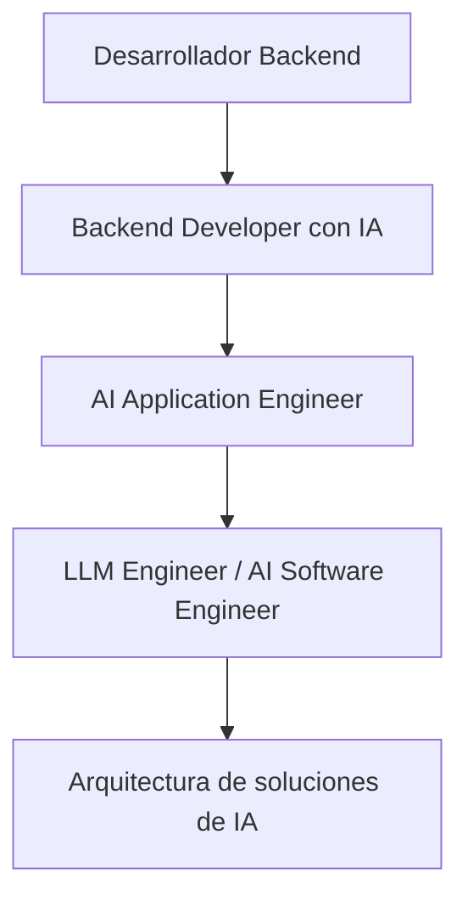
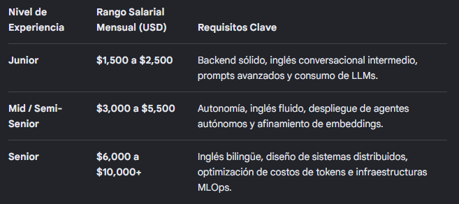

# ¿Tiene futuro esta especialización?
Sí, especialmente si combinas IA con ingeniería de software. Una empresa no necesita únicamente alguien que sepa escribir prompts: necesita sistemas que procesen datos, respeten permisos, respondan correctamente, controlen costos y se integren con sus aplicaciones

---

### 📌 Explicación
- **Desarrollador Backend:** Logica, base técnica, APIs y bases de datos.  
- **Backend Developer con IA:** integración inicial de modelos IA en el backend.  
- **AI Application Engineer:** diseño de aplicaciones que combinan backend + IA.  
- **LLM Engineer / AI Software Engineer:** especialista en modelos de lenguaje y optimización.  
- **Arquitectura de soluciones de IA:** visión global, diseña cómo se conectan todos los componentes.  

---
### 👉 ¿Cuánto podrías ganar?

Para Perú, distinguiría entre un puesto junior que integra IA y un puesto especializado de ingeniería de IA. No utilizaría los salarios de un ingeniero sénior para valorar una vacante de entrada.

Como referencia concreta, una oferta publicada para un desarrollador backend junior de Python orientado a agentes de IA y automatizaciones en Perú indicaba S/ 2,000–2,500 mensuales. 

Las guías salariales para puestos de IA más especializados muestran cifras considerablemente superiores, pero corresponden a otros niveles de responsabilidad y no son una promesa salarial para un principiante.

---

Un desarrollador Backend especializado en Inteligencia Artificial (que integra LLMs, crea pipelines de RAG y agentes autónomos) cuenta con un perfil altamente cotizado. Al combinar la lógica de servidores con la IA, los sueldos superan significativamente a los de un desarrollador backend tradicional.

Los rangos estimados de ingresos mensuales por nivel de experiencia son los siguientes:

### 👉En Perú (Mercado Local)
Si trabajas en planilla o régimen local para empresas basadas en el país, los salarios suelen pagarse en Soles (PEN):
• Junior (0-2 años): S/ 5,000 a S/ 6,500 al mes. En este nivel se espera que domines el backend base (Python, Node.js) y sepas consumir y conectar APIs de IA (como OpenAI o Anthropic).
• Mid / Semi-Senior (2-5 años): S/ 7,500 a S/ 11,000 al mes. Aquí ya diseñas arquitecturas híbridas y automatizaciones de flujos de IA con herramientas como LangChain o n8n.
• Senior (5+ años): S/ 12,000 a S/ 16,000+ al mes. Orientado a roles de liderazgo técnico o arquitectura de software, optimizando infraestructura en la nube para modelos de IA y bases de datos vectoriales

🌎 En el Extranjero (Remoto / Contractor desde Perú)

# 📈 Estrategias para alcanzar cifras millonarias con IA

Para alcanzar estas cifras, debes migrar hacia modelos de negocio basados en **escalabilidad, propiedad intelectual y valor masivo**. Aquí tienes el mapa de ruta con las 4 estrategias más viables:

---

## 1. El Modelo Micro-SaaS (Software como Servicio) 🚀
La vía más directa para un desarrollador: crear un software pequeño que resuelva un problema hiper-específico con IA y cobrar suscripción mensual.

- **Meta $500K/año → $41,600/mes**
  - 416 clientes pagando $100/mes.
  - 83 clientes corporativos pagando $500/mes.
- **Enfoque de IA:** No competir con OpenAI, sino crear capas de valor encima (ej. backend de IA para lectura de facturas y conciliación bancaria; optimizador de rutas para logística).
- **Ventaja:** Escalabilidad automática. Si facturas $500K, puedes vender la empresa por 3–5 veces su valor anual.

---

## 2. Consultoría o Agencia de Automatización de IA (B2B) 🏢
Las empresas tradicionales necesitan IA pero no saben integrarla. Aquí actúas como consultor estratégico.

- **Meta $1M/año → $83,300/mes**
  - 4 clientes grandes pagando $20,000/mes cada uno.
  - O 10 proyectos de $100,000 al año.
- **Ejemplo:** Sistema RAG privado para el área legal de un banco.
- **Enfoque de IA:** MLOps, privacidad de datos, optimización de costos.
- **Propuesta de valor:** “Te ahorro $200K al año en consumo de tokens y protejo tus datos con un modelo local open-source (ej. Llama 3).”

---

## 3. Solopreneur / Infoproductos y Herramientas 🛠️
Empaquetar conocimiento y vender componentes de software.

- **Estrategia:**
  - Plantillas de backend listas (Node/Python, pagos, auth, agentes IA) → $200–$300.
  - Licencias de APIs especializadas hosteadas por ti.
- **Ventaja:** Margen de ganancia ~95%. No necesitas empleados, solo marca personal fuerte en X/Twitter, GitHub o LinkedIn.

---

## 4. Equity en Startups de Alto Crecimiento 📈
Unirte como CTO o co-founder técnico en una startup con capital de riesgo.

- **Salario base:** $100K–$150K.
- **Equity:** 5%–15% de acciones.
- **Ejemplo:** Si la startup vale $20M, tu equity puede convertirse en $1M+.
- **Ventaja:** Combinas salario + participación en el crecimiento exponencial.

---

# 🛠️ Kit de Habilidades Técnicas Obligatorias

Para sostener infraestructuras que valgan millones, debes dominar:

1. **Orquestación Avanzada:** arquitecturas multi-agente complejas (LangGraph, CrewAI).  
2. **Eficiencia de Costos (FinOps para IA):** caching de prompts, routers de LLMs (usar modelos baratos antes de los costosos), fine-tuning de open-source.  
3. **Bases de Datos Vectoriales a Escala:** manejo eficiente de millones de embeddings en Pinecone, Qdrant o Milvus.  
