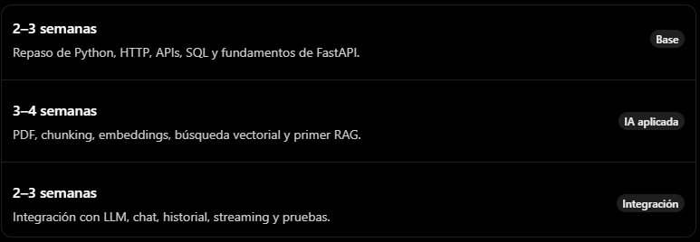
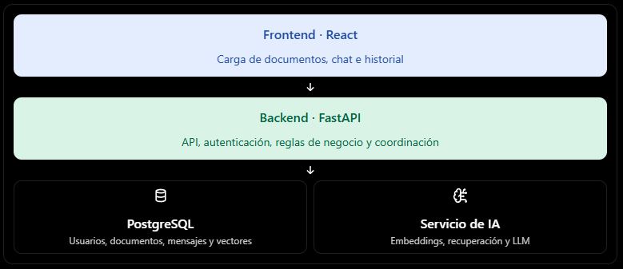
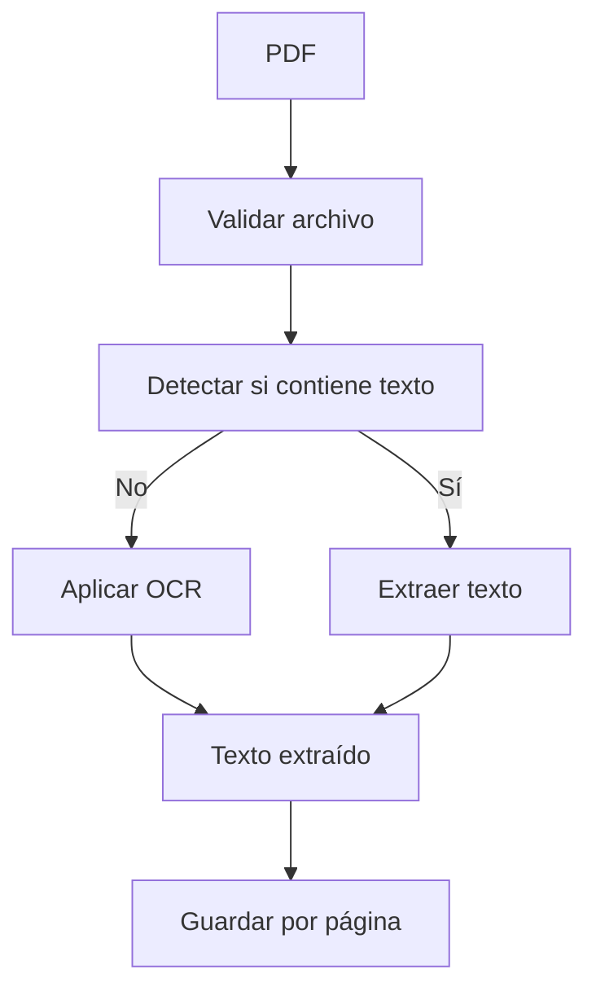
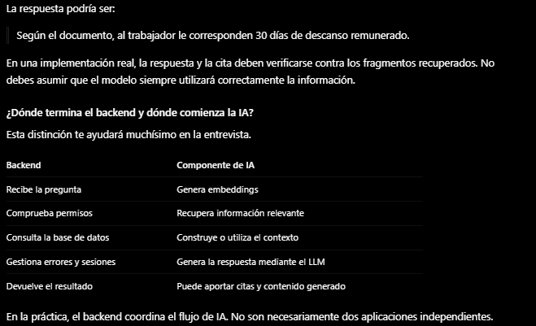
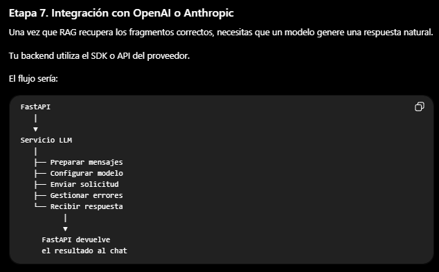
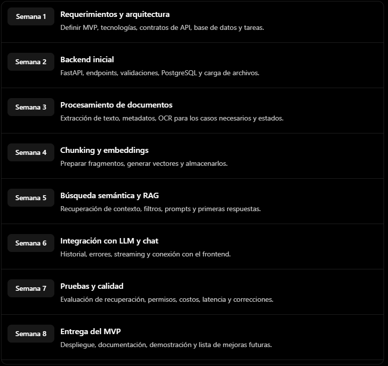
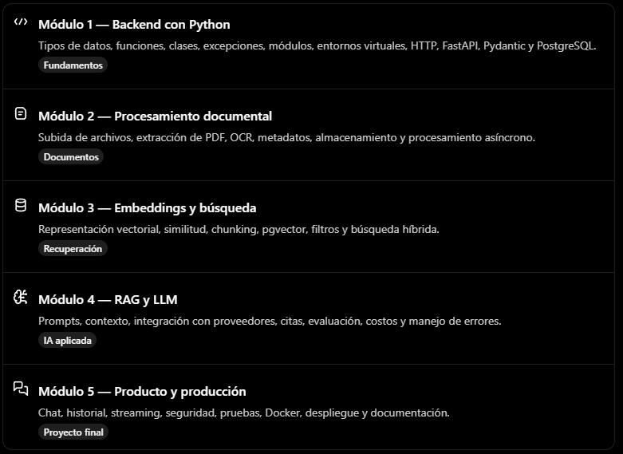

## ¿Cuánto tiempo necesitas para prepararte?

Tomando como referencia unas 3 horas de estudio al día:



En aproximadamente 8–10 semanas podrías construir un MVP y adquirir una base razonable para una entrevista junior, siempre que practiques programando. Para alcanzar un nivel intermedio sólido en todo el conjunto, considera varios meses de práctica adicional.

No esperes a terminar toda la formación para postular. Si la entrevista es pronto, prioriza Python, APIs, el flujo de RAG y la integración con un LLM.

## BLOQUE 2. Las 30 preguntas de entrevista que debes dominar

Las siguientes preguntas están ordenadas desde fundamentos hasta decisiones técnicas. Las respuestas son modelos breves: debes comprenderlas y poder explicarlas con tus propias palabras.

# A. Python, backend y procesamiento de documentos

# 📘 Preparación Técnica: Backend + IA

## A. Python, backend y procesamiento de documentos

**01 · Python**  
¿Qué diferencia hay entre una lista, una tupla, un conjunto y un diccionario?  
- Lista: colección ordenada y mutable.  
- Tupla: ordenada e inmutable.  
- Conjunto: almacena elementos únicos.  
- Diccionario: pares clave-valor.  

**02 · Python**  
¿Qué son las excepciones y cómo las manejas?  
- Son errores en ejecución.  
- Uso `try/except` para gestionarlos, registro el problema y devuelvo respuesta apropiada.  

**03 · Python**  
¿Qué diferencia hay entre programación síncrona y asíncrona?  
- Síncrona: cada operación debe terminar antes de continuar.  
- Asíncrona: aprovecha tiempos de espera (ej. HTTP) con `async/await`.  

**04 · FastAPI**  
¿Qué es FastAPI y por qué lo utilizarías?  
- Framework para construir APIs en Python.  
- Facilita validación, documentación OpenAPI y programación asíncrona.  

**05 · Arquitectura**  
¿Cómo organizarías un backend?  
- Separar rutas, esquemas, lógica de negocio, acceso a datos y configuración.  

**06 · REST**  
¿Qué endpoints diseñarías para gestionar documentos y conversaciones?  
- Ejemplo:  
  - `POST /documents`  
  - `GET /documents`  
  - `POST /conversations`  
  - `POST /conversations/{id}/messages`  
  - `GET /conversations/{id}/messages`  

**07 · Documentos**  
¿Cómo procesarías un PDF?  
- Validar archivo, extraer texto, conservar metadatos, limpiar contenido y enviarlo al siguiente paso.  

**08 · OCR**  
¿Qué haces si el PDF contiene páginas escaneadas?  
- Uso OCR para reconocer texto en imágenes, verifico calidad y mantengo correspondencia con páginas.  

**09 · Persistencia**  
¿Qué guardarías en la base de datos?  
- Documentos, propietario, estado, fragmentos, metadatos, conversaciones y mensajes.  

**10 · Seguridad**  
¿Cómo protegerías la carga de documentos?  
- Validar tamaño, formato, autenticación, autorización, nombres seguros y limitar recursos.  

---

## B. RAG, embeddings y búsqueda vectorial

**11 · RAG**  
¿Qué es RAG?  
- Retrieval-Augmented Generation: combina recuperación de información con generación contextualizada.  

**12 · Embeddings**  
¿Qué es un embedding?  
- Representación numérica (vector) para comparar similitudes semánticas.  

**13 · Chunking**  
¿Por qué dividir un documento en chunks?  
- Para recuperar partes relevantes sin enviar todo el documento.  

**14 · Chunking**  
¿Qué es el overlap y qué problema resuelve?  
- Superposición entre fragmentos consecutivos. Evita pérdida de contexto.  

**15 · Vector DB**  
¿Qué es una base de datos vectorial?  
- Almacena vectores y permite búsquedas por similitud.  

**16 · Similitud**  
¿Qué es la similitud coseno?  
- Métrica que compara orientación de dos vectores.  

**17 · Recuperación**  
¿Qué significa top-k?  
- Recuperar los k resultados más relevantes.  

**18 · Calidad**  
¿Qué harías si RAG devuelve fragmentos irrelevantes?  
- Revisar extracción, tamaño de chunks, embeddings, filtros y aplicar reranking.  

**19 · Alucinaciones**  
¿Cómo reduces respuestas inventadas?  
- Proporcionar contexto relevante, instrucciones claras y citas de fuentes.  

**20 · Evaluación**  
¿Cómo medirías la calidad de un RAG?  
- Verificar fragmentos correctos, respaldo de respuesta, citas y revisión humana.  

---

## C. OpenAI, Anthropic e integración con LLM

**21 · LLM**  
¿Qué diferencia hay entre un LLM y un modelo de embeddings?  
- LLM: genera contenido.  
- Embeddings: convierten contenido en vectores.  

**22 · APIs**  
¿Cómo integrarías OpenAI o Anthropic desde Python?  
- Configurar credenciales, usar SDK/API, validar respuesta y devolverla al cliente.  

**23 · Prompts**  
¿Qué función tiene el prompt de sistema?  
- Define instrucciones generales y restricciones del modelo.  

**24 · Costos**  
¿Cómo controlarías el costo de llamadas a un LLM?  
- Limitar tokens, elegir modelo adecuado, aplicar límites de uso y registrar costos.  

**25 · Resiliencia**  
¿Qué harías si el proveedor de IA falla?  
- Manejar timeouts, reintentos, errores y devolver respuesta controlada.  

---

## D. Chat, streaming e integración con aplicaciones

**26 · Streaming**  
¿Qué es streaming y para qué sirve en un chat?  
- Enviar partes de la respuesta conforme se generan, reduciendo la espera.  

**27 · Historial**  
¿Cómo guardarías el historial de una conversación?  
- Guardar mensajes con roles, contenido, fechas y metadatos.  

**28 · Integración**  
¿Cómo integrarías este servicio de IA en un sistema empresarial?  
- Exponer endpoints autenticados, contratos de datos y respetar reglas de negocio.  

**29 · Seguridad de IA**  
¿Qué es prompt injection y cómo lo abordarías?  
- Instrucciones maliciosas en documentos. Validar entradas y limitar permisos.  

**30 · Diseño del sistema**  
¿Cómo desarrollarías un asistente para cientos de PDF?  
- API de carga, extracción/OCR, chunks, embeddings, vector DB, recuperación, chat, historial, seguridad y despliegue.  

---

# BLOQUE 3. Cómo se trabaja realmente en un proyecto de backend e IA

Imaginemos el proyecto **DocuMind**, un asistente que permite subir documentos empresariales y hacerles preguntas.

- **Etapa 1. Reunión inicial:** entender requerimientos.  
  Preguntas clave:  
  - ¿Quiénes usarán el sistema?  
  - ¿Qué tipos de documentos subirán?  
  - ¿Tamaño máximo de PDF?  
  - ¿Privados por usuario o compartidos por empresa?  
  - ¿La IA debe indicar documento y página?  
  - ¿Guardar conversaciones?  
  - ¿Qué pasa si no hay respuesta en el documento?  
  - ¿Qué tecnologías usa actualmente la empresa?  

# 📘 Documento de Requerimientos – Proyecto DocuMind

El Resultado de la Etapa 1: Documento de Requerimientos

### Requerimientos iniciales de DocuMind
- El usuario puede subir un PDF.  
- El sistema extrae el texto del documento.  
- El usuario puede realizar preguntas sobre el documento.  
- La IA responde utilizando información recuperada del PDF.  
- La respuesta muestra la fuente y la página, cuando corresponda.  
- El usuario puede consultar el historial de conversaciones.  

**¿Por qué hacemos esto?**  
Porque el requerimiento inicial es solo una idea. El trabajo del desarrollador es convertir esa idea en **funcionalidades concretas** que se puedan desarrollar, probar y entregar.

---

## Etapa 2: Dividir el trabajo y definir la arquitectura

Ahora el equipo decide cómo construir el sistema.  

### Arquitectura inicial propuesta:
1. **Frontend (Cliente/Interfaz de usuario)**  
   - Permite subir documentos PDF.  
   - Muestra el chat con IA y el historial de conversaciones.  

2. **Backend (FastAPI/Django)**  
   - Gestiona autenticación y permisos.  
   - Expone endpoints para documentos y conversaciones.  
   - Coordina el flujo de procesamiento.  

3. **Procesador de documentos (OCR/PDF)**  
   - Extrae texto de PDFs.  
   - Aplica OCR en páginas escaneadas.  
   - Limpia y normaliza contenido.  

4. **Motor de embeddings**  
   - Convierte texto en vectores.  
   - Prepara datos para búsqueda semántica.  

5. **Base de datos vectorial (Pinecone/Qdrant)**  
   - Almacena embeddings y metadatos.  
   - Permite recuperar fragmentos relevantes.  

6. **Pipeline RAG**  
   - Recupera fragmentos relevantes.  
   - Pasa contexto al modelo de lenguaje.  

7. **LLM (OpenAI/Anthropic)**  
   - Genera respuestas basadas en contexto.  
   - Devuelve resultados al backend.  

8. **Monitoreo y seguridad**  
   - Logs de uso y rendimiento.  
   - Validación de entradas y protección contra ataques (ej. prompt injection).  



En esta etapa se decide qué tecnología utilizar, cómo se comunicarán los componentes y quién desarrollará cada parte.

Por ejemplo, tú podrías encargarte de la API de documentos, mientras otro desarrollador trabaja en RAG y un tercero en React.

No siempre se divide así: en equipos pequeños es habitual que una persona desarrolle varias partes.

## Etapa 3. Backend: construir la estructura del sistema

Aquí empieza tu trabajo de programación.

Piensa en el backend como el encargado de recibir solicitudes, comprobarlas, ejecutar las reglas del negocio, comunicarse con la base de datos y devolver resultados.

En DocuMind, el backend debe responder preguntas como:

¿Quién está subiendo el documento?

¿El archivo es válido?

¿Dónde se guardará?

¿Cómo se registra en PostgreSQL?

¿Cuándo se procesa?

¿Qué usuario puede consultarlo?

## 3.1. Preparar el proyecto

Una estructura sencilla podría ser:

# 📂 Estructura de Proyecto

```plaintext
documind/
├── app/
│   ├── main.py
│   ├── api/
│   │   ├── documents.py
│   │   └── conversations.py
│   ├── schemas/
│   │   ├── document.py
│   │   └── chat.py
│   ├── services/
│   │   ├── document_service.py
│   │   └── chat_service.py
│   ├── repositories/
│   │   └── document_repository.py
│   ├── models/
│   └── core/
│       └── config.py
├── tests/
├── .env
└── requirements.txt
```

# 📘 Proyecto DocuMind – Backend + IA

## Etapa 3. Arquitectura y primeros pasos

### 3.1. Responsabilidad de cada carpeta
- **api/** → Recibe las solicitudes HTTP.  
- **schemas/** → Valida la estructura de los datos.  
- **services/** → Contiene la lógica del negocio.  
- **repositories/** → Consulta y guarda información.  
- **models/** → Representa las entidades de la base de datos.  
- **core/** → Configuración y componentes comunes.  

Ejemplo: cuando el usuario sube un PDF, el endpoint recibe la solicitud, el servicio coordina el proceso y el repositorio guarda los datos correspondientes.

---

### 3.2. Crear el primer endpoint
```python
from fastapi import FastAPI

app = FastAPI(title="DocuMind API")

@app.get("/health")
def health_check():
    return {"status": "ok"}
```
Ejemplo de carga de archivos

```python
from fastapi import UploadFile, File, HTTPException

@app.post("/documents/upload")
async def upload_document(file: UploadFile = File(...)):
    if not file.filename.lower().endswith(".pdf"):
        raise HTTPException(
            status_code=400,
            detail="Solo se permiten archivos PDF"
        )
    return {"filename": file.filename, "status": "received"}
```
Este ejemplo es únicamente una demostración inicial. En un sistema real todavía tendrías que validar el contenido, limitar el tamaño, gestionar el almacenamiento y aplicar permisos.

Tu primer objetivo es que la API reciba correctamente un documento. Todavía no necesitas IA.

### 3.3. Conectar PostgreSQL
Luego necesitas persistir la información.
Una tabla documents podría contener:

Cuando se sube un documento, el backend registra sus datos y devuelve un identificador.

### 📂 Una Tabla de la tabla `documents` podria contener

| Campo        | Propósito                |
|--------------|---------------------------|
| id           | Identificador             |
| user_id      | Propietario               |
| filename     | Nombre original           |
| storage_path | Ubicación del archivo     |
| status       | Estado de procesamiento   |
| created_at   | Fecha de registro         |

Cuando se sube un documento, el backend registra sus datos y devuelve un identificador.
Por ejemplo:

```python
{
  "document_id": 42,
  "status": "uploaded"
}
```
¿Por qué importa esto? Porque el usuario necesita poder consultar después el documento, ver si terminó de procesarse y utilizarlo en una conversación.

## 3.4. Probar el backend

Antes de seguir, pruebas los endpoints desde Swagger o Postman.

### Compruebas:

- ¿La API recibe el PDF?

- ¿Rechaza archivos no permitidos?

- ¿Guarda el registro?

- ¿Devuelve errores comprensibles?

- ¿Se puede recuperar el documento?

Esta etapa se considera terminada cuando la funcionalidad cumple los criterios acordados, no simplemente cuando el código deja de mostrar errores.

## Etapa 4. Procesamiento de documentos: convertir archivos en información

Ahora tenemos un PDF almacenado. Pero todavía no podemos buscar información dentro de él.

Necesitamos extraer su contenido.


# 📊 Flujo de procesamiento de documentos PDF



## 4.1. Extraer texto

Puedes utilizar librerías como PyMuPDF o pdfplumber para extraer texto de PDFs que contienen texto digital.

El resultado debe conservar, siempre que sea posible, la página de origen.

Ejemplo:
```
Documento: manual.pdf

Página 1:
Objetivo del procedimiento...

Página 2:
Responsabilidades del trabajador...

Página 3:
Procedimiento de solicitud...
```
No es suficiente con obtener una sola cadena de texto si después quieres mostrar citas y páginas.

## 4.2. ¿Cuándo entra OCR?

Imagina que el documento es una fotografía escaneada de un contrato.

Aunque visualmente puedas leerlo, el PDF podría no contener texto seleccionable.

El OCR reconoce los caracteres de la imagen y los transforma en texto.

Herramientas posibles: Tesseract, servicios OCR en la nube u otras soluciones especializadas.

No debes aplicar OCR indiscriminadamente a todos los documentos. Primero comprueba si realmente lo necesitan.

## 4.3. Guardar el resultado

El backend puede guardar el texto extraído y los metadatos necesarios.

Un documento puede tener estados como:
```
uploaded
   ↓
processing
   ↓
completed
```
Si falla el OCR o la extracción, puedes registrar un estado failed y permitir que el sistema gestione el error.

Para documentos grandes, este procesamiento suele ejecutarse mediante una tarea en segundo plano, en lugar de mantener abierta la solicitud HTTP durante todo el proceso.

---

## Etapa 5. IA: convertir los documentos en información recuperable

Aquí comienza la parte específica de IA aplicada.

Hasta ahora, el sistema sabe recibir documentos y extraer texto. Ahora queremos que encuentre información relevante para responder preguntas.

## 5.1. Chunking: dividir el texto

Supongamos que el documento contiene 30.000 palabras.

Enviar todo el texto a un modelo cada vez que el usuario hace una pregunta puede ser costoso e ineficiente.

Por eso dividimos el contenido en fragmentos.

```
Texto extraído
      │
      ▼
┌──────────────┐
│ Chunk 1      │
└──────────────┘
┌──────────────┐
│ Chunk 2      │
└──────────────┘
┌──────────────┐
│ Chunk 3      │
└──────────────┘
       ```

      cada fragmento conserva informacin de origen.
      ```
      {
  "document_id": 42,
  "page": 3,
  "chunk_index": 7,
  "content": "El trabajador debe presentar..."
}
```

El tamaño del fragmento y el solapamiento deben probarse con documentos y preguntas reales. No existe una configuración universal que sea la mejor para todos los casos.

## 5.2. Embeddings: representar los fragmentos mediante vectores

Ahora utilizas un modelo de embeddings.

El texto de cada chunk se transforma en un vector numérico.

```
Chunk
  │
  ▼
Modelo de embeddings
  │
  ▼
Vector numérico
```
---
Ese vector se almacena asociado al texto original.

Importante: el vector no reemplaza al texto. Normalmente necesitas guardar ambos, porque el vector sirve para buscar y el texto sirve para construir el contexto que recibirá el LLM.

## 5.3. Guardar los vectores

Para tu caso, una opción razonable es PostgreSQL con pgvector.

Así puedes conservar los datos empresariales tradicionales y los vectores dentro de una misma plataforma, aunque debes diseñar correctamente las consultas y los índices.

La tabla de fragmentos podría tener:

```mermaid
document_chunks
├── id
├── document_id
├── page
├── content
├── embedding
└── metadata
```
En este punto ya tienes los documentos preparados para realizar una búsqueda semántica.

## Etapa 6. RAG: responder preguntas utilizando los documentos
Esta es la parte que debes aprender a explicar sin dudar.

Imagina que el usuario pregunta:

¿Cuántos días de vacaciones le corresponden al trabajador?

El sistema ejecuta un proceso diferente al de la carga del documento.

```
## Flujo de una pregunta

1. Recibir la pregunta

FastAPI recibe el mensaje y comprueba que el usuario tenga permiso para consultar el documento.

2. Generar el embedding de la pregunta

El modelo transforma la pregunta en un vector compatible con los vectores almacenados.

3. Buscar fragmentos relevantes

PostgreSQL con pgvector recupera los chunks más similares, aplicando los filtros de acceso necesarios.

4. Construir el contexto

El backend reúne la pregunta y los fragmentos recuperados, conservando sus fuentes y páginas.

5. Llamar al LLM

Envía el contexto al modelo para generar una respuesta.

6. Devolver la respuesta

El backend devuelve el texto y, cuando se ha implementado, las referencias a los documentos y páginas utilizados.
```
---


Un prompt podría indicarle al modelo:

```
Responde utilizando la información del contexto.

Si el contexto no contiene la respuesta,
indica que no hay información suficiente.

Contexto:
[Fragmentos recuperados]

Pregunta:
¿Cuántos días de vacaciones le corresponden
al trabajador?
```





Aquí debes comprender:

Cómo autenticarte mediante una API key.

Cómo enviar mensajes al modelo.

Cómo controlar los tokens de entrada y salida.

Cómo gestionar límites, errores y tiempos de espera.

Cómo registrar latencia y consumo.

Cómo cambiar de modelo sin acoplar toda la aplicación a un proveedor.

La clave es que tu aplicación no debe depender de que una llamada externa siempre funcione. El proveedor puede estar lento, rechazar una solicitud o alcanzar un límite de uso.

Además, las claves deben permanecer en el backend, no en React.

Etapa 8. Chat, historial y streaming

Ahora el sistema ya puede responder preguntas. Falta convertirlo en una experiencia de usuario.

Historial

Necesitas guardar las conversaciones y sus mensajes.

Una estructura sencilla:

```
conversations
├── id
├── user_id
└── created_at

messages
├── id
├── conversation_id
├── role
├── content
└── created_at
```


Cuando el usuario vuelve a abrir una conversación, el backend recupera sus mensajes y los muestra.

Recuerda que guardar el historial no significa que debas enviar todos los mensajes al modelo en cada solicitud. Debes seleccionar el contexto relevante y controlar su tamaño.

Streaming

Sin streaming, el usuario espera hasta recibir la respuesta completa.

Con streaming, el backend envía partes de la respuesta a medida que llegan del proveedor.

Para una comunicación principalmente del servidor al navegador, SSE puede ser una buena opción

```
React
  │
  │ pregunta
  ▼
FastAPI
  │
  ▼
LLM
  │
  │ fragmentos de respuesta
  ▼
FastAPI
  │
  │ SSE
  ▼
React muestra el texto progresivamente
```


Debes gestionar también desconexiones, errores durante la transmisión y la finalización del mensaje.

## Etapa 9. Integración, pruebas y entrega

Antes de dar por terminado el MVP, el equipo debe verificar el recorrido completo:

El usuario sube un PDF.

El sistema extrae el texto o aplica OCR.

Los fragmentos se generan y almacenan.

Los embeddings se guardan correctamente.

La pregunta recupera información relevante.

El LLM genera una respuesta fundamentada.

El chat muestra la respuesta y sus fuentes.

El historial conserva la conversación.

Los permisos impiden consultar documentos ajenos.

Los errores se registran y se gestionan correctamente.

No basta con que funcione con un único PDF perfecto. Hay que probar documentos escaneados, archivos defectuosos, preguntas sin respuesta, usuarios diferentes y fallos del proveedor.


BLOQUE 4. ¿Cómo organizaría los dos meses de trabajo?

Este sería un ejemplo de planificación para un equipo pequeño. No es una promesa de que todo se terminará en ese plazo; es una manera razonable de ordenar el trabajo.


---
Si trabajan varias personas, muchas tareas pueden desarrollarse en paralelo. Por ejemplo, el frontend puede construir la interfaz con datos simulados mientras el backend implementa los endpoints.

La condición es que el equipo acuerde previamente cómo se comunicarán los componentes.

Qué preguntaría yo al entrar al proyecto

Estas preguntas te ayudarían a no empezar perdido:

¿Qué funcionalidades deben estar listas al finalizar los dos meses?

¿Ya existe código o se empieza desde cero?

¿Qué arquitectura y tecnologías están definidas?

¿Qué parte del sistema será mi responsabilidad?

¿Ya existe un proveedor de LLM y una base vectorial?

¿Quién define y revisa los contratos de las APIs?

¿Cómo gestionamos las tareas, las revisiones de código y las pruebas?

¿Qué se considera terminado para cada funcionalidad?

Y durante el desarrollo, en vez de esperar a que alguien te resuelva todo, utiliza este método:

Investiga → plantea una solución → prueba → muestra el resultado → pide revisión → corrige.

BLOQUE 5. Tu plan de formación personal

Quiero que aprendas por proyectos, no por acumulación de tecnologías.

Tu proyecto de práctica será DocuMind, el asistente de documentos que acabamos de diseñar. Puedes usarlo como laboratorio para adquirir experiencia y luego aplicar lo aprendido a Venus.
